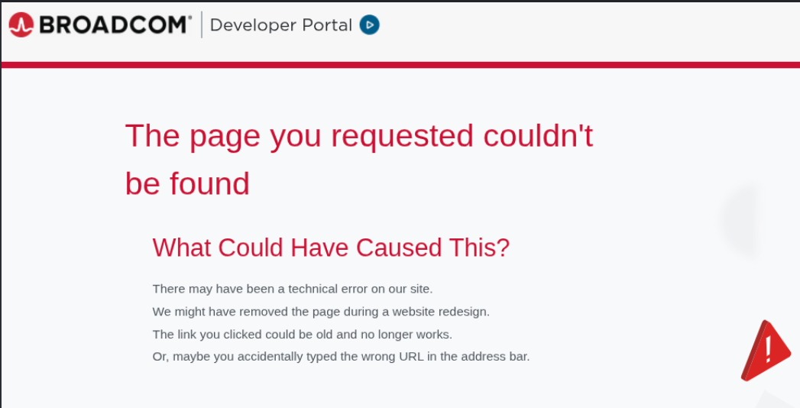
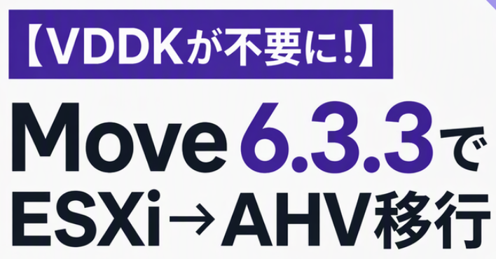

***Broadcoms innstramming i tilgangen til VMware Virtual Disk Development Kit (VDDK) viser hvordan et proprietært bibliotek kan bli en flaskehals for kundenes exit-strategi. Med DirectPath i Nutanix Move 6.3.3 kan virtuelle maskiner migreres fra VMware ESXi til Nutanix AHV uten VDDK.*** 

Skal du migrere fra VMware ESXi til Nutanix AHV, men står fast på tilgangen til VDDK? DirectPath i Nutanix Move 6.3.3 fjerner denne avhengigheten fra datakopieringen. Det betyr én mindre ekstern komponent å hente inn, godkjenne og vedlikeholde – særlig relevant i isolerte miljøer. Færre avhengigheter gjør veien videre enklere, men migreringen krever fortsatt littegrann planlegging og testing.

# VDDK vs. Move = 0 - 1 

- 25. august 2026 forsvant VMwares Virtual Disk Development Kit (VDDK) fra Broadcoms offentlige nedlastingsside. 
- 13. oktober kom Nutanix Move 6.3.3 med en migreringsmetode som ikke trenger den. **Det er bare 49 dager.**

I den siste tiden har det vært ganske mange migreringssamtaler som har startet med «hvor får vi tak i VDDK?» For ESXi –> AHV 

Svaret er nå: du trenger den ikke.  ………………   Nice!

## Hva Broadcom gjorde 

VDDK er VMware’s SDK for å lese og skrive VM-disker. Backupverktøy bruker det, og det samme gjør migreringsverktøy: Azure Migrate, Red Hat Migration Toolkit for Virtualization og også Nutanix Move. Inntil i høst kunne hvem som helst laste det ned fra Broadcoms utviklerside. Men Broadcom var slemme og linken gir nå bare *feilmelding*.

Broadcoms begrunnelse er lisens-teknisk. Ifølge TechTarget mener Broadcom at VDDK kun er ment for backup og gjenoppretting hos lisensierte Broadcom-kunder, at det «ikke er en kunderettighet», og at endringen bare håndhever eksisterende vilkår. Tilgang skjer nå gjennom utvalgte partnere i Broadcoms teknologiprogram.

Tja, og juridisk kan jo Broadcom sikkert ha rett.  Men virkningen er likevel den samme: verktøyene kundene bruker for å forlate plattformen, mister en byggekloss. Dette kalles på fagspråket for Lock-In, eller leverandørbinding. Exit strategi blir vanskeligere, men ikke umulig. 

## La oss ikke sutre, men løse problemet

Nutanix har ikke brukt høsten på å klage.  Move 6.3.3 er generelt tilgjengelig (GA) og introduserer **DirectPath**, som overfører diskdataene fra ESXi til AHV uten å benytte seg av VDDK.

Til sammenligning sa Red Hat til TechTarget 9. september at de ikke har en direkte erstatning ennå, fordi VDDK er proprietær programvare. Det er absolutt *<u>ingen</u>* kritikk av Red Hat. Men, det viser bare hvor dypt avhengigheten satt i hele bransjen, og at det ikke var gitt at noen skulle løse det raskt.

Nutanix Move hadde forsåvidt allerede én VDDK-fri vei: zero-copy-migrering med Everpure FlashArray og vVols (Move 6.3.0 og nyere, AOS 7.6 og nyere). Den krever riktig lagring.  

**DirectPath** gjelder vanlig datakopiering, og det er der de fleste har utgangspunktet sitt.

## Hva er DirectPath?

Du legger til vCenter eller ESXi-hosten som source, lager en migreringsplan og så trykker du Start. Nutanix Move gjør det den alltid har gjort: *seeder* data mens *source*-VM-en kjører, holder den synkronisert og lar deg velge et tidspunkt for en  *cutover*.

DirectPath er ingen ny migreringsfilosofi. Den tar bort én forutsetning eller én bevegelig del fra kjeden, men jeg vil tro at det  betyr mer enn det kanskje høres ut som.

**Dark Sites** 

Mange av de nordiske kundene vi jobber med, kjører Air-Gappede miljøer. Der må hver eksterne binærfil hentes, godkjennes, skannes og lastes inn. Et tredjepartsbibliotek som plutselig blir Utilgjengelig, kan jo faktisk sette et prosjekt på vent i flere uker. Ikkje bra.

## Praktiske tips før du starter

- **Fersk utrulling.** Move 6.3.3 støtter kun nye utrullinger. Du kan ikke oppgradere til den, og ikke fra den. Behold gammel applianc til de migreringsplanene  som kjører, er ferdige.

- **vCenter Rettigheter .** ESXi som source krever «*Provisioning: Allow virtual machine download*» og «*Cryptographic Operations: Direct Access*». Her er det bare å bestikke og godsnakke med *Broadcom by VMware* -admin. 
  I “vel-regulerte” firma kan en endring i rettigheter ta lengre tid enn selve migreringen.  

- **Kompatibilitet.** Supportert konfigurasjon
  - AOS 6.10, 7.0, 7.3, 7.5 og 7.6. 
  
  - ESXi 6.5 til 8.0 U3, vCenter 6.7 til 9.0. 
  
  - ESXi med gratislisens støttes ikke. Men sjekk mot release notes, just in case.
  
- **Unike datastore-navn.** Kjent problem: DirectPath kan feile når to clustere i samme datasenter har en datastore med likt navn (og ulikt innhold). 5 min. med litt inventory sparer deg for tulle-feil.

- **Interne nett.** Nutanix Move bruker 172.17.0.0/16 og 172.18.0.0/16 internt. Om du ellers har IP adresser i disse områdene i ditt miljø, vil du sannsynligvis planlegge rundt det. 

## Ærlighet

DirectPath er jo helt nytt. Nutanix har ikke noe offentlige ytelsestall som viser hvordan den performer opp mot VDDK-metoden. Test selv. Velg en håndfull representative VM-er, f.eks. èn Windows, en Linux og kanskje noe med flere disker, kjør dem hele veien i en pilot. Les dokumentasjonen og sjekk for *kjente feil*. 

Hva du enn lover, ikke lov null nedetid. Nutanix Move holder selvfølgelig avbrudd veldig kort fordi mesteparten av dataene kopieres mens VM-en kjører. Selve cut-over er likevel en reell event: source-VM-en slås av, siste synkronisering kjøres, og VM-en starter på destinasjonen på Nutanix AHV. 

Det er sikkert en god idè å ha en grei dialog med de som er applikasjonseierne, ha en plan for rollback (Nutanix Move er relativt god på sånt), og test og valider applikasjonene, ikke bare VM-en når alt er over på den andre siden.

> ## TLDR
>
> Broadcom strammet inn på tilgangen til et verktøy hele bransjen har bygget all migrering på. 
>
> Nutanix ga oss kode, ikke pressemeldinger. 
>
> For de som har stått fast etter **“no more VDDK for you”**, er hinderet nå blitt borte. 
>
> For the record;  *Jeg arbeider i Nutanix.*
>

#Nutanix #NutanixMove #DirectPath #VMware #Broadcom #VDDK #Migrering #Virtualisering #Leverandørbinding #ExitStrategi #AirGapped #lockIn 

---

**kilder**

- Nutanix Community, «Nutanix Move 6.3.3», 13. oktober 2026: https://next.nutanix.com/product-updates/nutanix-move-6-3-3-45958
- TechTarget, Beth Pariseau, «Broadcom confirms change in VMware migration tool access», 9. september 2026: https://www.techtarget.com/it-infrastructure/news/366648768/Broadcom-confirms-change-in-VMware-migration-tool-access
- It's FOSS, «Broadcom Kills Public VDDK Access to Tighten its Grip on VMware», 9. september 2026: https://itsfoss.com/news/broadcom-removes-vmware-vddk-downloads/
- Nutanix Move 6.3 User Guide, avsnitt «Zero-Copy Migration Requirements»
