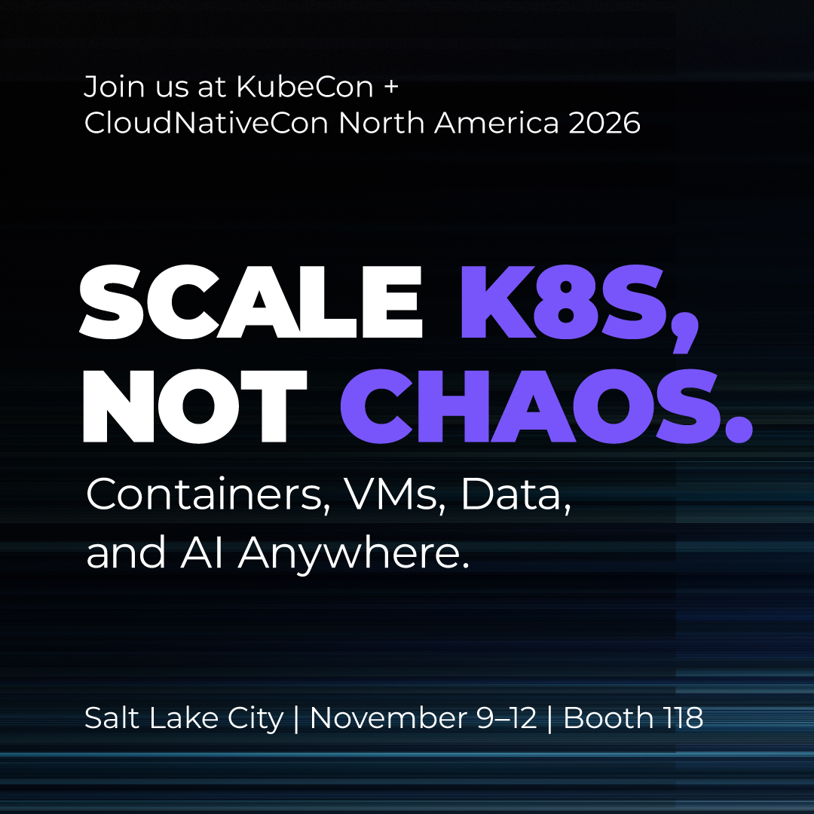

Nutanix joins the KubeCon keynote line-up as a Diamond sponsor. Our engineering sessions tackle AI governance, GitOps recovery and Kubernetes fleet management. The connection to Nutanix Kubernetes Platform (NKP) and Enterprise AI (NAI) is practical: *bring modern workloads to the infrastructure and data businesses already run.*

# Nutanix and friends

So - What do Google, Meta, NVIDIA, Anthropic, AWS, the Linux Foundation, the Cloud Native Computing Foundation (CNCF) and Nutanix have in common?

They all have speakerslots in the [KubeCon + CloudNativeCon North America keynote line-up](https://events.linuxfoundation.org/kubecon-cloudnativecon-north-america/), **9–12 November 2026 in Salt Lake City**.

**Meet Nutanix at booth 118.** Containers, VMs, data and AI anywhere. Nutanix also shares the [Diamond sponsor tier](https://events.linuxfoundation.org/kubecon-cloudnativecon-north-america/sponsor/sponsor-directory/) with AWS, Google Cloud and Anthropic, alongside Microsoft Azure, Red Hat and others.   Still thinking of Nutanix mainly as a virtualization platform? Look at the programme!!

# Three sessions worth opening
Nutanix Cloud Native CTO **Deepak Goel** has three listed sessions. Here is what they address. Times are local, MST.

| Session | When | Why attend? |
| --- | --- | --- |
| [Govern AI before it acts: Envoy AI Gateway + Kyverno](https://events.linuxfoundation.org/kubecon-cloudnativecon-north-america/program/schedule/?id=1334821) | 10 Nov, 16:30–16:55 | With Jim Bugwadia: apply policy to model and Model Context Protocol (MCP) traffic before agents execute tool calls. |
| [GitOps Meltdown: when a commit deletes 39 clusters](https://events.linuxfoundation.org/kubecon-cloudnativecon-north-america/program/schedule/?id=1250559) | 10 Nov, 17:30–18:00 | Trace a Flux failure and learn how to limit destructive reconciliation and recover. |
| [Cluster API with CAREN: standardised, yet adaptable](https://events.linuxfoundation.org/kubecon-cloudnativecon-north-america/program/schedule/?id=1293929) | 12 Nov, 09:39–09:44 | A sponsored keynote on customising cluster lifecycle through runtime hooks while preserving shared blueprints. |

These **topics** run through the wider [schedule](https://events.linuxfoundation.org/kubecon-cloudnativecon-north-america/program/schedule/). Google examines agent identity and execution; Meta shares its move towards GitOps for AI infrastructure. Nutanix addresses the same operational questions: what may automation do, and how do we recover when it goes wrong?

Among the **featured keynote speakers**, just like NUTANIX, several have particularly busy programmes: Andrey Velichkevich from Apple has 4 sessions. Lucy Sweet from Anthropic, Vara Bonthu from AWS, and Deepak Goel from NUTANIX all have 3 sessions each. 

# Why Nutanix belongs in this conversation

- Nutanix is a [Linux Foundation and CNCF member](https://www.nutanix.com/opensource). Its involvement reaches into engineering: an [open-source Cluster API provider](https://github.com/nutanix-cloud-native/cluster-api-provider-nutanix) and [Cilium-based networking in NKP](https://www.cncf.io/case-studies/nutanix/) are concrete examples.

- My view: investing in shared APIs and projects makes commercial sense. Customers want supported operations while retaining familiar Kubernetes tools and skills.

- [Nutanix Kubernetes Platform (NKP)](https://www.nutanix.com/blog/production-ai-meets-dual-native-choice-with-nkp) brings NKP Metal, a curated AI catalogue and upgrade workflows with validation. [Nutanix Enterprise AI (NAI)](https://www.nutanix.com/solutions/ai) adds model serving, inference endpoints and governed access to models and tools.

> Within **Nutanix Cloud Platform (NCP)**, **Nutanix Cloud Infrastructure (NCI)** supplies the infrastructure foundation. Running NKP and NAI alongside existing virtual machines brings AI closer to business applications and private data, reducing the need to create another infrastructure silo.
>
> The **deployment choices** extend beyond that stack: Kubernetes at the edge, supported public-cloud environments, and direct hardware access through NKP Metal. NAI can also run on supported Kubernetes services such as Amazon EKS, Azure AKS and Google GKE. Hardware, storage and support requirements still depend on the deployment.
>

**That is the bigger story: enterprise Kubernetes and AI, connected to the systems that already run the business.**  Open the three sessions. Then explore [Nutanix’s cloud-native platform](https://www.nutanix.com/cloud-native) with your own applications and operating requirements in mind.

#Kubernetes #AI #CloudNative #KubeCon #Nutanix #NKP #PlatformEngineering
